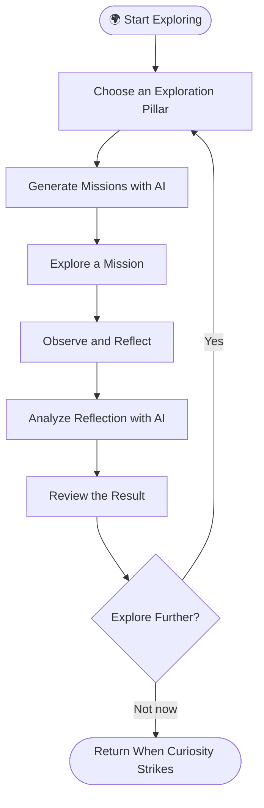
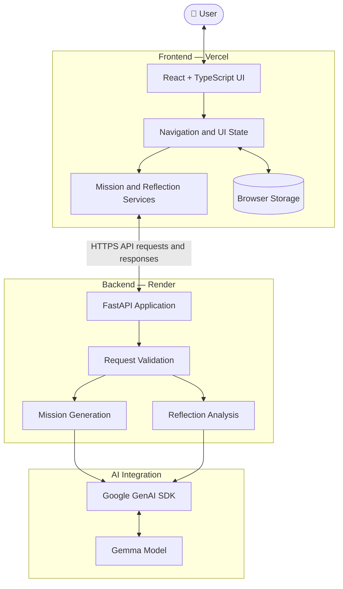
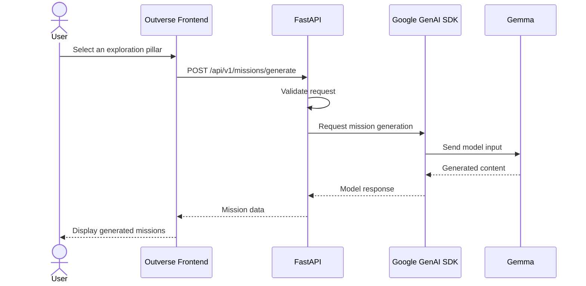
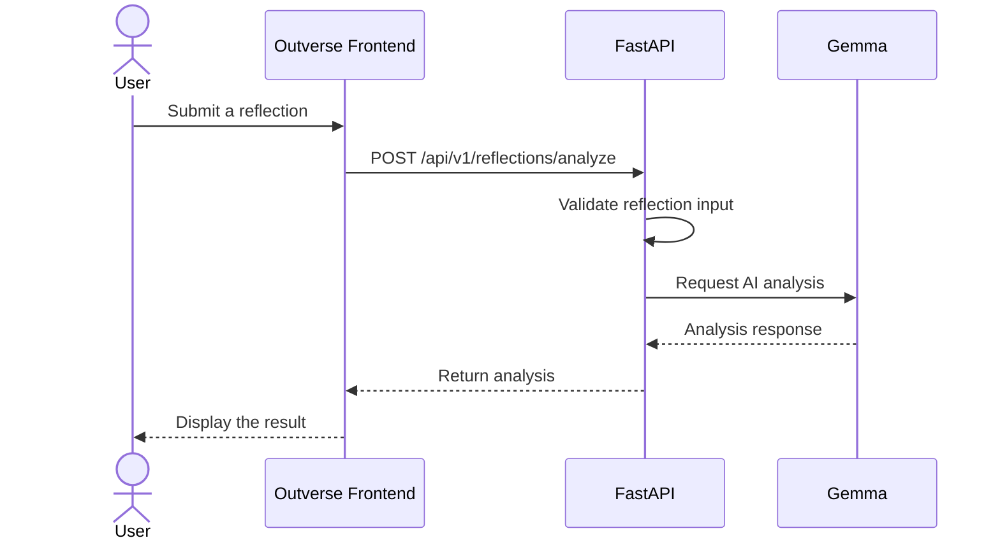

# ✳ Outverse — Look Closer. Find More.

### An AI-powered exploration experience for the things we usually overlook.

<p align="center">
  <a href="https://outverse-touchgrass.vercel.app">
    <strong>🌐 Explore Outverse — Live App</strong>
  </a>
  &nbsp; · &nbsp;
  <a href="https://github.com/ivy1o1/outverse">
    <strong>💻 View Source Code</strong>
  </a>
</p>

---

## 🌿 What is Outverse?

We move through the world every day, surrounded by patterns, stories, systems, and traces of human life that we rarely stop to notice.

**Outverse is built to change that.**

It is an AI-powered exploration platform that uses generated missions and reflection analysis to encourage curiosity, observation, and deeper engagement with the world around us.

Rather than treating AI as another chatbot that answers questions for you, Outverse uses AI to help structure an exploration experience — giving you something to investigate, observe, and reflect on.

> **The idea is simple: don't just consume information. Go out, look closer, and discover something.**

## ✨ Explore the Four Pillars

Outverse organizes exploration around four themes.

| 🌱 Pillar | 🔎 What it explores |
|---|---|
| **Hidden Patterns** | Recurring behaviors, unexpected connections, and details hiding in plain sight. |
| **Forgotten Stories** | Overlooked histories, perspectives, and stories that deserve attention. |
| **Invisible Systems** | The infrastructure, rules, and relationships shaping everyday life. |
| **Human Traces** | The experiences, choices, memories, and activities people leave behind. |

Each pillar offers a different lens through which to look at the same world.

## 🧭 How Outverse Works

The experience follows a simple loop: **choose → explore → reflect**.



The goal is to connect AI-generated prompts with the user's own observations and reflections, rather than make the AI the center of the experience.

## 🪄 Features

- **AI-powered mission generation** — Generate exploration missions based on a selected pillar.
- **Four exploration pillars** — Approach the world through patterns, stories, systems, and human traces.
- **Reflection analysis** — Submit reflections to the backend for AI-powered analysis.
- **Mission-focused interface** — Explore through a visual, card-based experience.
- **Field Journal and browser persistence** — Keep supported data locally in the browser.
- **Immersive visual design** — Editorial layouts, animated transitions, and a nature-inspired interface.
- **Separate frontend and backend** — A React application communicates with a FastAPI service that handles model requests.

## 🏗️ System Architecture

Outverse separates the user experience from backend processing and AI integration.



### What each layer does

| Layer | Responsibility |
|---|---|
| **Frontend** | Displays the interface, handles user interaction, and manages client-side state. |
| **Service layer** | Sends mission-generation and reflection-analysis requests to the backend. |
| **FastAPI backend** | Validates requests, coordinates application logic, and returns API responses. |
| **Google GenAI SDK** | Connects backend operations to the configured model. |
| **Gemma** | Supports mission generation and reflection analysis. |
| **Browser storage** | Persists supported state locally on the user's device. |

The frontend does not need direct access to the model API key. AI requests are handled by the backend.

## 🔄 Inside the AI Pipeline

### Mission generation



### Reflection analysis



The exact analysis output depends on the backend schema, prompt, and model response.

## 🎨 Design System

Outverse's visual identity takes inspiration from nature, editorial design, and the feeling of keeping a field journal.

| Element | Design direction |
|---|---|
| **Palette** | Forest greens, moss, parchment, and warm orange accents |
| **Layout** | Editorial composition with deliberate spacing and hierarchy |
| **Cards** | Visual mission cards designed around exploration |
| **Typography** | Expressive display text paired with readable supporting text |
| **Motion** | Transitions, reveals, and interactive feedback that support navigation |
| **Experience** | Calm, tactile, immersive, and curiosity-driven |

### Design principles

- **Curiosity over clutter:** Keep the experience focused on discovery.
- **Motion with purpose:** Animation should support the experience, not compete with it.
- **Observation over passive consumption:** Encourage people to engage with the world around them.
- **AI as a tool:** Use AI to support exploration without replacing the user's own perspective.

## 🧰 Tech Stack

| Technology | Role |
|---|---|
| React | Frontend UI |
| TypeScript | Frontend type safety |
| Vite | Frontend build tooling |
| Tailwind CSS | Styling |
| Motion, GSAP, and CSS techniques | Animation and transitions |
| Lucide React | Icons |
| Python | Backend language |
| FastAPI | API framework |
| Pydantic | Request validation and data schemas |
| Google GenAI SDK | Model integration |
| Gemma | AI model |
| Vercel | Frontend hosting |
| Render | Backend hosting |

## 📁 Project Structure

The repository is organized into frontend and backend applications.

```text
outverse/
├── frontend/
│   ├── public/
│   ├── src/
│   │   ├── components/       # Reusable interface components
│   │   ├── pages/            # Application views
│   │   ├── services/
│   │   │   ├── missionService.ts
│   │   │   └── reflectionService.ts
│   │   └── ...               # Routes, hooks, state and styling
│   ├── package.json
│   └── vite.config.ts
│
├── backend/
│   ├── main.py               # FastAPI app and endpoints
│   ├── app/
│   │   ├── __init__.py
│   │   ├── schemas.py         # Data validation schemas
│   │   └── gemma.py           # Model integration
│   └── requirements.txt
│
└── README.md
```

*This is a high-level map of the known structure. Consult the repository for the exact current file tree.*


## 🗃️ Data and Persistence

Outverse uses browser storage for supported local state.

This means:

- Supported data can persist across refreshes in the same browser.
- Data is not automatically synchronized between devices.
- Clearing browser storage can remove locally persisted information.
- Browser storage is not a replacement for a secure database or authenticated account system.

## 🛡️ Security and Current Limitations

Outverse is deployed, but there is still room to harden it for broader public use.

- **Model availability:** Requests can fail because of provider errors, quota limits, or rate limits.
- **Public API protection:** Rate limiting and usage controls should be implemented before exposing AI endpoints to substantial traffic.
- **CORS:** Restricts browser-based cross-origin requests; it does not authenticate callers or stop direct API requests.
- **Persistence:** Browser-local state does not provide account-based synchronization.
- **Testing:** Automated tests and stronger regression coverage would improve reliability.
- **Performance:** The frontend has previously produced a nonfatal large-bundle warning, so code splitting may improve load performance.

These are known engineering considerations, not claims that the features are already implemented.

## 🛣️ What's Next?

Potential improvements include:

- [ ] Add API rate limiting and abuse protection.
- [ ] Expand automated frontend and backend tests.
- [ ] Improve model error handling and user-facing failure states.
- [ ] Optimize frontend bundle size and loading performance.
- [ ] Add optional account-based persistence.
- [ ] Improve accessibility and reduced-motion support.
- [ ] Expand mission history and reflection management.
- [ ] Document exact API schemas and error responses.


## 🌍 Why Open Innovation?

Outverse explores how AI can support curiosity without replacing human judgment.

Open-source development gives others the opportunity to examine the implementation, suggest improvements, contribute new ideas, and challenge the assumptions behind the product.

The aim is to build technology that helps people engage more deeply with the world — and to make the process of building that technology open to collaboration.

---

<p align="center">
  <strong>✳ Outverse</strong><br/>
  <em>Look closer. Find more.</em><br/><br/>
  <a href="https://outverse-tau.vercel.app">Explore the live application →</a>
</p>
